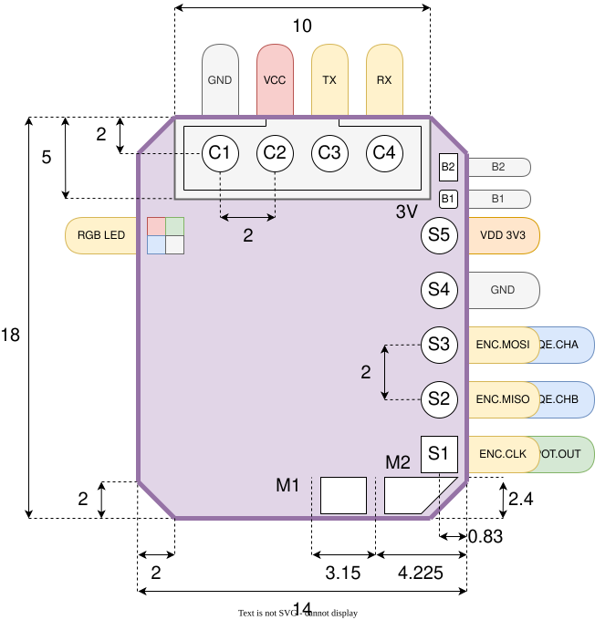

# Servio PCB

| pin | function | description |
| --- | -------- | ---- |
| C1  | GND | ground for main connector |
| C2  | VCC | input power for main connector |
| C3  | TX | UART communication TX pin |
| C4  | RX | UART communication RX pin |
| S1  | ENC.CLK,POT.OUT | CLK for SPI encoder, input pin for potentiometer |
| S2  | ENC.MISO,QE.CHB | MISO for SPI encoder, B channel for quadrature encoder |
| S3  | ENC.MOSI,QE.CHA | MOSI for SPI encoder, A channel for quadrature encoder |
| S4  | GND | GND for side connector |
| S5  | VDD 3V3 | MCU voltage for side connector |
| M1  | M1 | motor pin 1 |
| M2  | M2 | motor pin 2 |
| B1  | VDD 3V3 | voltage for boot mode |
| B2  | BOOT0 | pin triggering boot mode |